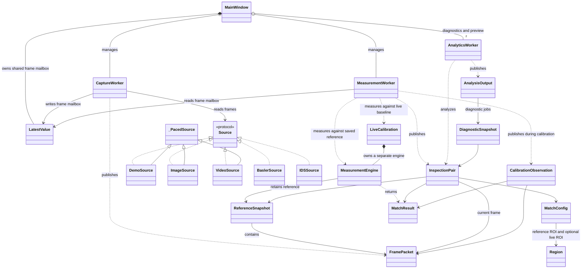
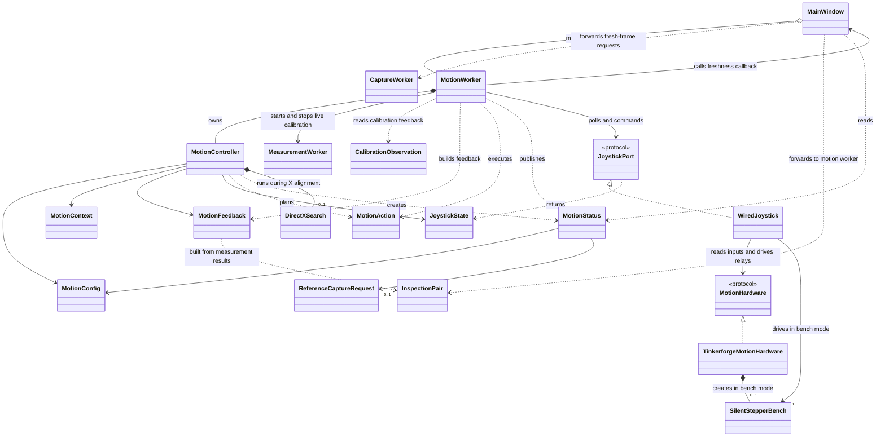

# Class diagram

## Capture, measurement, and analytics

`MainWindow` creates the shared `LatestValue` frame mailbox. `CaptureWorker` publishes `FramePacket` objects to it, and `MeasurementWorker` and `MainWindow` read it independently. `MainWindow` runs two `AnalyticsWorker` instances, one for diagnostic snapshots and one for display previews.

## Motion control

`MainWindow` forwards inspection results to `MotionWorker` and routes its fresh-frame requests to `CaptureWorker`. Each request sets an acquisition cutoff and returns a generation that the motion controller uses to validate feedback. During pixel calibration, `MotionWorker` reads `CalibrationObservation` objects from `MeasurementWorker` so feedback is measured against the pre-move live baseline. The controller uses `DirectXSearch` for automatic X alignment.

